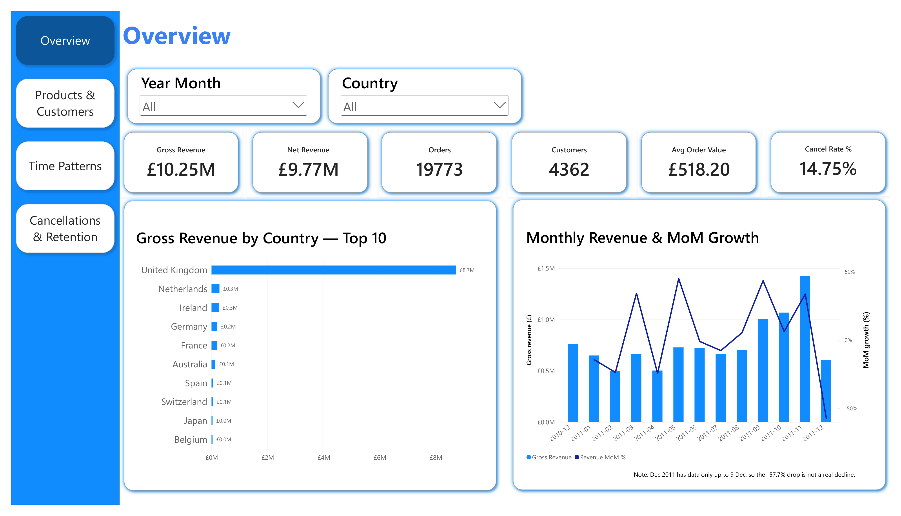
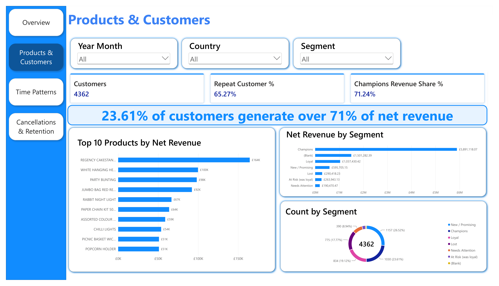
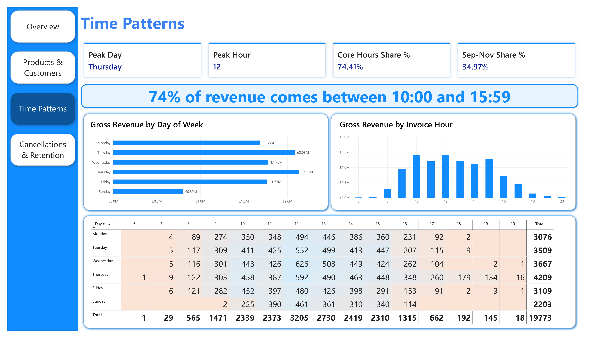
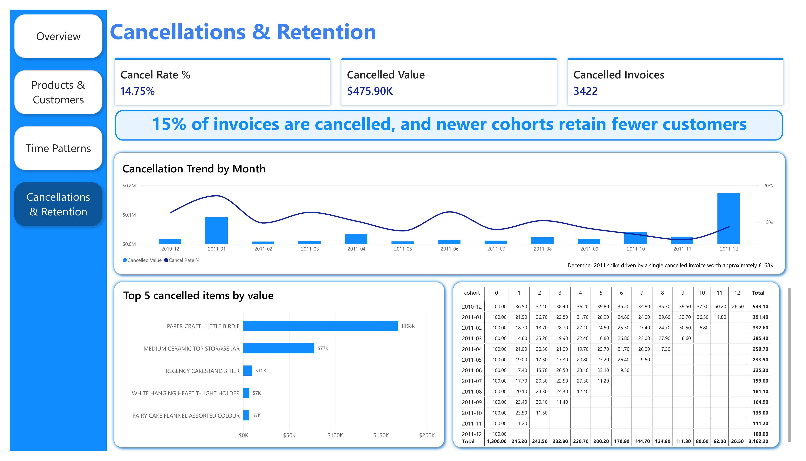

# E-commerce Sales Analytics

An end-to-end sales analytics project using a real-world online retail dataset. Python is used for data cleaning, MySQL for data storage and analysis, and Power BI for building an interactive dashboard.

The goal is to transform approximately 540K raw transaction rows into actionable business insights on revenue trends, customer value, retention, and cancellations.

## Table of Contents

- [Dataset](#dataset)
- [Tech Stack](#tech-stack)
- [Project Structure](#project-structure)
- [Pipeline](#pipeline)
- [Key Insights](#key-insights)
- [Dashboard](#dashboard)
- [Getting Started](#getting-started)
- [Data Caveats](#data-caveats)
- [License](#license)

## Dataset

The project uses the [Online Retail dataset](https://archive.ics.uci.edu/dataset/352/online+retail) from the UCI Machine Learning Repository. The dataset contains transactions from a UK-based online gift retailer between December 1, 2010, and December 9, 2011. Many of its customers are wholesalers.

| Column | Description |
|---|---|
| `InvoiceNo` | Invoice number. Prefix `C` indicates a cancellation. |
| `StockCode` | Product code |
| `Description` | Product name |
| `Quantity` | Number of units per transaction line |
| `InvoiceDate` | Invoice timestamp |
| `UnitPrice` | Price per unit in GBP |
| `CustomerID` | Customer identifier, missing for approximately 25% of rows |
| `Country` | Customer country |

The dataset is downloaded automatically using `ucimlrepo`, so no manual download is required.

## Tech Stack

| Layer | Tools |
|---|---|
| Data cleaning | Python, pandas |
| Storage and analysis | MySQL, SQL, CTEs, window functions, views |
| Data loading | SQLAlchemy, PyMySQL, python-dotenv |
| Visualization | Power BI Desktop |

## Project Structure

```text
ecommerce-sales-analytics/
├── data/
│   ├── raw/                     # Raw CSV, automatically downloaded
│   └── processed/               # Cleaned CSV
├── python/
│   ├── data_cleaning.py         # Download, clean, and engineer features
│   └── load_to_mysql.py         # Load data into MySQL and reconcile
├── sql/
│   ├── 01_create_schema.sql     # Database, table, and indexes
│   ├── 02_data_quality_checks.sql
│   ├── 03_sales_analysis.sql    # 14 analysis queries
│   └── 04_powerbi_views.sql     # RFM and cohort views for Power BI
├── powerbi/
│   └── ecommerce_dashboard.pbix
├── reports/
│   └── business_insights.md     # Full business analysis
├── images/                      # Dashboard screenshots
├── requirements.txt
└── README.md
```

## Pipeline

### 1. Data Cleaning

File: `python/data_cleaning.py`

- Standardizes column names, text, and country labels, such as converting `EIRE` to `Ireland`.
- Removes duplicates and non-product lines, including postage, bank charges, manual adjustments, vouchers, and test codes.
- Removes rows with prices less than or equal to zero and invalid quantities.
- Assigns a consistent description to each stock code.
- Creates derived fields:
  - `is_cancelled`
  - `total_price`
  - `invoice_year`
  - `invoice_month`
  - `invoice_year_month`
  - `day_of_week`
  - `invoice_hour`

Result: 531,170 cleaned rows.

### 2. Load to MySQL

File: `python/load_to_mysql.py`

- Creates the database schema and loads the cleaned data in batches.
- Reconciles row counts and total revenue between the cleaned CSV and MySQL.
- Stops execution if the reconciliation checks fail.

### 3. Data Validation and SQL Analysis

Directory: `sql/`

- Performs data quality checks for missing values, duplicates, price and quantity rules, and cancellation flag consistency.
- Includes 14 analysis queries covering:
  - Business KPIs
  - Monthly revenue trends and month-over-month growth
  - Revenue by day of week and hour
  - Top products, countries, and customers
  - RFM customer segmentation
  - Repeat customer rate
  - Cohort retention
  - Cancellation analysis
  - Pareto analysis

### 4. Power BI Visualization

File: `powerbi/ecommerce_dashboard.pbix`

Builds a four-page interactive dashboard connected to MySQL and the analytical views.

## Key Insights

All revenue figures are reported in GBP. See [`reports/business_insights.md`](reports/business_insights.md) for the full analysis.

### Business KPIs

| Metric | Value |
|---|---:|
| Gross revenue | 10.25M |
| Net revenue after cancellations | 9.77M |
| Orders | 19,773 |
| Average order value | 518 |
| Identified customers | 4,362 |
| Repeat customer rate | 65.3% |

### Key Findings

- Seasonality: September to November 2011 generated 3.58M in gross revenue, representing 35% of the year's total. November peaked at 1.45M.
- Trading patterns: Tuesday and Thursday accounted for 41% of revenue. Approximately 74% of revenue was generated between 10:00 and 15:59. No Saturday transactions were recorded.
- UK market dependence: The UK contributed 85.1% of revenue. The Netherlands and Ireland ranked next, but their revenue came from only 9 and 3 customers, respectively, suggesting a high concentration of wholesale accounts.
- Customer value concentration: The top 20% of customers generated 73.7% of net revenue. Champions represented approximately 24% of scored customers and contributed 71.2% of net revenue.
- Customer retention: Month-one retention ranged from 15% to 24% for most 2011 cohorts. The December 2010 cohort performed best, with 50% of customers remaining active in November 2011.
- Cancellation impact: 14.8% of invoices were cancellations. Two products with high gross unit sales were almost entirely cancelled. Therefore, product rankings are based on net revenue rather than gross units sold.

### RFM Segmentation

| Segment | Customers | Net revenue share |
|---|---:|---:|
| Champions | 1,030 | 71.2% |
| Loyal | 834 | 12.5% |
| New / Promising | 1,157 | 7.2% |
| Lost | 775 | 3.5% |
| At Risk | 134 | 3.2% |
| Needs Attention | 390 | 2.3% |

RFM segmentation uses Recency, Frequency, and Monetary value to categorize customers based on how recently they purchased, how frequently they purchase, and how much they spend.

## Dashboard

The Power BI report contains four interactive pages with year-month and country filters.

| Page | Focus |
|---|---|
| Overview | Headline KPIs, revenue by country, monthly revenue, and month-over-month growth |
| Products & Customers | Top products and customers, RFM segments |
| Time Patterns | Revenue by day of week and hour of day |
| Cancellations & Retention | Cancellation rates and cohort retention |

### Dashboard Screenshots

| Overview | Products & Customers |
|---|---|
|  |  |

| Time Patterns | Cancellations & Retention |
|---|---|
|  |  |

## Getting Started

### Prerequisites

- Python 3.10+
- MySQL 8.0+
- Power BI Desktop to open and refresh the dashboard

### Installation

Clone the repository and install the dependencies:

```bash
git clone https://github.com/DanrayHT/ecommerce-sales-analytics.git
cd ecommerce-sales-analytics

python -m venv .venv
source .venv/bin/activate
# Windows: .venv\Scripts\activate

pip install -r requirements.txt
```

### Configure MySQL

Create a `.env` file in the project root:

```env
MYSQL_USER=root
MYSQL_PASSWORD=your_password
MYSQL_HOST=localhost
MYSQL_PORT=3306
```

Replace `your_password` with your actual MySQL password.

### Run the Pipeline

Step 1: Download and clean the data.

```bash
python python/data_cleaning.py
```

The cleaned CSV will be saved to:

```text
data/processed/online_retail_cleaned.csv
```

Step 2: Load the data into MySQL.

```bash
python python/load_to_mysql.py --recreate
```

The `--recreate` flag rebuilds the target table.

Step 3: Run the SQL scripts.

After the schema and data are ready, execute the scripts in order:

```bash
mysql -u root -p < sql/02_data_quality_checks.sql
mysql -u root -p < sql/03_sales_analysis.sql
mysql -u root -p < sql/04_powerbi_views.sql
```

Run `01_create_schema.sql` first if the schema has not already been created.

Step 4: Open the Power BI dashboard.

Open `powerbi/ecommerce_dashboard.pbix` in Power BI Desktop, configure the data source to connect to the local `ecommerce_analytics` MySQL database, and refresh the data.

## Data Caveats

- Partial final month: December 2011 contains data only through December 9. The apparent 57.7% decline does not represent a true decline in business performance.
- Missing customer IDs: Approximately 24.8% of rows have no `CustomerID`. These transactions are included in revenue calculations but excluded from RFM, cohort, and repeat purchase analyses.
- Gross vs. net revenue: Monthly gross revenue is inflated by several large orders that were cancelled shortly afterward, including approximately 168K in December 2011 and 77K in January 2011. Net revenue accounts for cancellations.
- Single year of data: Seasonality patterns should be validated using multiple years of data.
- Business-defined RFM thresholds: Different scoring thresholds would change customer segment assignments.

## License

This project is intended for educational and portfolio purposes. The dataset is provided by the UCI Machine Learning Repository and is subject to its own terms of use.